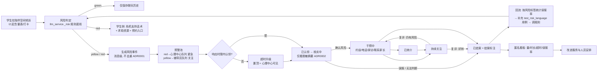
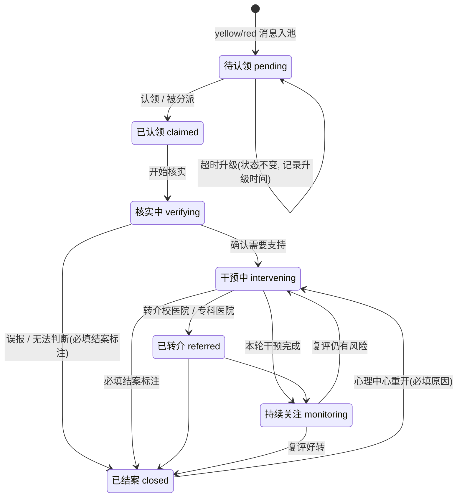

# 智伴方舟高校版 · 迭代需求文档 PRD v2

> 版本：v2.0 草案 · 2026-10-08
> 适用范围：单校部署的现有 FastAPI + Next.js + SQLite 项目（`Intelligent_Ark`）
> 与现有文档的关系：`PDRs/PRD.md` 继续描述**当前已实现的基线**；本文描述**下一阶段的迭代目标**。实施期间 `AGENTS.md`（删除确认、数据保留）、`PDRs/Delivery_Playbook.md`（验收口径、证据规则）、`GLOSSARY.md` 和 `docs/adr/` 继续有效。本文与 ADR 冲突的地方，一律以 ADR 为准，冲突项列在第 13 节“开放问题”。
> 读者：实现本迭代的开发 Agent（Cursor）以及项目负责人。

---

## 0. 阅读约定

- **需求编号**：`模块前缀-序号`，例如 `POOL-03`。前缀：`COMP` 陪伴空间、`TOOL` 自助工具、`RISK` 风险识别、`POOL` 预警池、`CASE` 跟进（个案）、`ADM` 管理与配置、`SEC` 安全合规、`NFR` 非功能、`DOC` 文档与测试。
- **优先级**：P0 = 闭环必需，缺了 Iteration 1 不能演示；P1 = 本期应做，可降级；P2 = 后续迭代。注意它和 `PDRs/Delivery_Playbook.md` 里的**缺陷**等级 P0/P1/P2 不是一回事：本文的 P 是**需求**优先级。
- **迭代**：`I1` / `I2` / `I3`，见第 11 节。
- **文件指针**：只列编写本文时仓库文件清单中真实存在的文件；凡是根据文件名和文档**推断**出来的，都标“（推断）”。需要新建的文件不写具体文件名，只写放在哪个已有目录下，命名由实现者按现有风格决定。
- **术语**：严格使用 `GLOSSARY.md`。本文新增的术语（见 4.3）在 I1 中补进 GLOSSARY。注意：“风险事件”不叫“预警/告警”；“高校工作人员”指人时不写“管理员”；“陪伴空间”不写“聊天页”。

---

## 1. 背景与目标

### 1.1 背景

现有版本已经跑通了“学生倾诉 → 关键词规则分级 → 黄/红风险事件入预警池 → 高校工作人员标记已跟进”的最小链路，并且通过了 S0–S3-05 的本地隔离验收（见 `PDRs/Delivery_Playbook.md` 第 8 节）。但从“心理陪伴与风险预警系统”的完整业务闭环来看，跟进仍然只有一步“标记已跟进”，存在这些问题：

1. **没有责任人和时限**：谁负责、多久必须响应、超时怎么办，都没有定义，红色事件可能在池子里无人认领。
2. **跟进过程没有留痕**：核实、约谈、转介、联系家长这些实际动作没有结构化记录，复评回访没有提醒。
3. **结果不回流**：结案时没有“确认风险 / 误报 / 无法判断”的标注，规则误报率无法度量，`PDRs/Risk_Rule_Acceptance.md` 要求的“发布前由学校心理支持人员审核误报/漏报风险”缺少数据来源。
4. **学生侧告知不足**：缺少首次使用的知情同意和保密例外说明，人设未明确声明“我是 AI，不是心理咨询师”，红色时的求助资源不能保证每次都显示（真实模型回复“并非都会被强制替换”）。
5. **角色单一**：工作端只有 G 类 `admin` 一种角色，辅导员和心理中心老师看到和能做的事完全一样。

### 1.2 目标

| 编号 | 目标 | 衡量方式 |
| --- | --- | --- |
| G1 | 每条风险事件都有明确负责人，并在响应时限内被认领；超时会被看见、被升级 | 红色事件认领时长、超时数在看板上可查；演示中可复现超时升级 |
| G2 | 跟进全过程可追溯：状态流转、跟进记录、复评提醒、结案标注都在数据库里，刷新后一致 | 演示脚本第 10 节全部步骤通过；审计日志可查 |
| G3 | 结案标注能回流到规则改进 | 能按风险标签导出确认风险/误报/无法判断的统计 |
| G4 | 学生知情、AI 身份透明、危机时一定能看到求助入口 | 首次进入陪伴空间必须先同意；红色回复一定带危机支持话术和求助资源 |
| G5 | 不破坏既有能力和验收 | `python scripts/verify_project.py` 退出码 0；既有 F01–F16 不退化（F08 按新口径更新） |

### 1.3 非目标（本 PRD 全周期都不做）

- 医学诊断、治疗建议、用药建议；任何把风险等级用于学生纪律、评优、学籍处理的功能。
- 多校共用一个实例（需先单独完成学校数据隔离，见 `PDRs/Delivery_Playbook.md`）。
- 工作台展示学生消息原文（ADR 0002）。
- 社区端、社交广场、支付、教务课表采集（沿用 `PDRs/Delivery_Playbook.md` 的范围约束）。

---

## 2. 设计原则

1. **AI 只陪伴和提示信号，判断由人做**：风险等级只是“流程辅助”，所有跟进决定都由高校工作人员做出并记录。
2. **规则是安全底线**：任何后续引入的模型判断只能**提高**等级或追加标签，不能降低规则给出的等级（I3 才引入，且须新 ADR）。
3. **消息级事件不变（ADR 0001）**：每条黄/红消息都是独立的风险事件，存储层不去重、不合并；需要“按学生看”时在事件之上做聚合视图。
4. **工作台只看脱敏摘要（ADR 0002）**：新增的事件详情、跟进记录、看板都不能带出学生消息原文。
5. **增量、可回滚的数据变更**：只加表、加列；历史数据保留；任何删除遵守 `AGENTS.md`。
6. **如实声明边界**：离线兜底、替身、未实测的能力不写成“已完成”（沿用 `PDRs/Delivery_Playbook.md` 的证据规则）。

---

## 3. 现状盘点

> 依据：`README.md`、`CLAUDE.md`、`AGENTS.md`、`PDRs/*` 以及仓库文件清单（含文件大小）。“已有”指文档声明已实现并有验收证据；“部分”指后端或局部已有但页面未接入，或能力不完整；“缺失”指文档和文件树中都没有。

### 3.1 已有能力（基线）

- **账号与鉴权**：学生学号注册/登录（`/login`），G 类工号登录工作台（`/admin-login`，注册仅经邀请码接口）；JWT HS256 + bcrypt + 双端 HttpOnly Cookie；middleware 路由守卫；会话失效恢复（S3-03 通过）。
- **陪伴空间 `/chat`**：JSON 对话 `/api/chat/stream`；历史加载/重试；发送失败恢复草稿；中文输入法防误发；ASR 语音回填后确认发送；人设“知心学姐/知心学长”，偏好按账号存于本浏览器。
- **自助工具**：每日治愈、能量补给电台、正念放松站、学业解压锦囊、情绪碎纸机、电子木鱼、打字发泄墙、专业支持热线（求助资源来自 `/api/scenario/context`）。
- **风险判定**：`llm_service._risk()` 单条消息关键词 + 片段排除规则，green/yellow/red，红 `92+3n`（封顶 98）、黄 `60+5n`（封顶 80）、绿 10；35 条合成样例（`backend/test_risk_language.py`）。
- **预警池**：黄/红写入 `risk_events`；`/admin` 三张概览卡 + 风险事件卡片列表，脱敏摘要、标签、分数；3/10/30 秒轮询；红色优先排序；“标记已跟进”（`POST /api/admin/alerts/{id}/handle`，`action=follow_up`）持久化，重复跟进不覆盖首次记录（S2-06）。
- **验收体系**：`scripts/verify_project.py` 统一入口（隔离临时库、随机端口、`.next-verify`），后端 14 项测试、13 组生产浏览器、8 组会话、8 组交互恢复、4 组偏好、168 组时间边界。

### 3.2 部分具备（后端已有、页面未接入或能力不完整）

- `GET /api/admin/risk-trend`、`GET /api/admin/risk-tags`、`GET /api/admin/users`、`GET /api/admin/users/{user_id}/activity`、`GET /api/admin/users/{user_id}/interventions`：后端已实现，工作台未接入。
- `DELETE /api/chat/history`：接口保留，页面无入口，本阶段不执行删除。
- `POST /api/chat/stream-sse`、`POST /api/tts`：预留能力。
- 红色时的现实支持提示：离线兜底一定带，真实模型只收到约束提示词，不保证每次都有。
- 数据表中有 `user_profiles`（`CLAUDE.md` 提到），可承载学生扩展资料（推断）。

### 3.3 差距表

| 能力（目标设计） | 现状 | 差距 | 计划 |
| --- | --- | --- | --- |
| AI 人设选择 | 已有：学姐/学长两种 | 缺“我是 AI，不是心理咨询师”的显式声明；偏好不跨设备 | 声明 I1；服务端保存偏好 I2；更多人设风格 I3（需改 GLOSSARY，见开放问题） |
| 长期记忆可查看/删除 | 缺失（模型只取最近 10 条历史） | 无记忆实体、无查看/删除入口；删除受 `AGENTS.md` 和留存策略约束 | I3，需先定留存策略 |
| 安全护栏 | 部分：提示词约束、黄色不虚构症状 | 缺“不提供自伤方法/不诊断/不建议用药”的统一提示词条款与回归测试 | 提示词与测试 I1；输出侧过滤 I2 |
| 危机话术 + 求助入口 | 部分：离线兜底与侧栏资源 | 红色回复不保证带固定话术与资源；资源不可按学校配置 | I1 |
| 首次知情同意与保密例外 | 缺失 | 无同意页面、无同意记录 | I1 |
| 情绪打卡/日记/趋势图 | 缺失 | 全新功能 | I2 |
| PHQ-9 / GAD-7 量表 | 缺失 | 全新功能；作为新的风险信号来源与 ADR 0001“消息级”定义冲突 | I2（需新 ADR） |
| 放松练习（呼吸/正念/睡眠音频） | 部分：正念放松站、能量补给电台、`frontend/public/sounds/` 音频 | 缺结构化呼吸引导 | I2（P2） |
| CBT 想法记录 | 缺失 | 全新功能 | I2 |
| 心理科普 | 部分：学业解压锦囊（推断为科普性质） | 缺分类文章库 | I2（P2） |
| 咨询预约 | 缺失 | 无预约系统；先做“预约入口”（学校配置的电话/链接） | 入口 I1；系统内预约见开放问题 |
| 多信号识别 | 部分：仅单条消息关键词 | 缺量表、打卡趋势、使用行为、跨轮上下文 | I2–I3 |
| 规则 + 模型 | 部分：仅规则 | 模型辅助判断未引入 | I3（须新 ADR，只升不降） |
| 4 级风险 | 冲突：现有 3 级 green/yellow/red（GLOSSARY） | 保留 3 级；新增“响应优先级”映射（见 RISK-02） | I1；是否细分见开放问题 |
| 信号合并为事件 | 冲突：ADR 0001 不去重 | 存储不合并；工作台提供“按学生分组”视图 | I1（P1） |
| 预警池筛选 | 部分：仅红色优先/按时间排序 | 缺按等级/状态/时间/队列筛选；学院维度无数据 | I1；学院 I2 |
| 响应时限与超时升级 | 缺失 | 全新 | I1 |
| 事件详情 | 缺失（仅卡片） | 缺详情页：摘要、标签、同一学生其他事件、状态流转、跟进记录 | I1 |
| 查看原文（授权+留痕） | 冲突：ADR 0002 禁止 | 保持不展示原文 | 见开放问题 |
| 认领/分派/自动路由 | 缺失 | 全新；需要工作人员子角色 | I1 |
| 跟进状态机 | 缺失（仅已跟进/未跟进） | 全新 | I1 |
| 跟进记录（约谈/电话/家访/转介/联系家长） | 部分：后端有 `interventions` 接口（内容未知） | 缺结构化记录写入与页面 | I1 |
| 复评提醒 | 缺失 | 全新（站内提醒） | I1 |
| 结案标注回流 | 缺失 | 全新 | I1 |
| 角色权限（按学院/角色） | 部分：单一 G 类 `admin` | 缺子角色；学生无学院字段 | 子角色 I1；学院范围 I2 |
| 配置人设/话术/规则/阈值 | 缺失（写在代码和 `.env`） | I1 用环境变量配置时限与求助资源；I2 做配置页面；规则配置化 I3 | I1–I3 |
| 匿名统计看板 | 部分：后端趋势/标签接口 | 缺页面；缺响应时长、超时、误报率指标 | I1（P1） |
| 审计日志 | 缺失 | 全新 | I1 |
| 加密、留存与删除策略 | 部分：bcrypt、参数化查询 | 缺字段加密、留存期限、删除流程 | 策略文档 I1；实现 I3 |

---

## 4. 角色、权限与术语

### 4.1 角色

| 角色 | 标识（建议） | 来源 | 主要职责 |
| --- | --- | --- | --- |
| 学生 | `student` | 现有 | 倾诉、使用自助工具、同意/撤回知情同意 |
| 辅导员 | `admin` + `staff_role=counselor` | 新增子角色 | 跟进黄色（关注）队列；接受心理中心分派 |
| 心理中心老师 | `admin` + `staff_role=center` | 新增子角色 | 跟进红色（紧急）队列；可改派任何事件；可重开已结案事件；看看板 |
| 系统配置人员 | `admin` + `staff_role=sysadmin` | 新增子角色 | 看看板和审计日志；维护配置；**默认不能查看单个学生的风险事件**（最小必要） |

- 继续沿用 `role=admin`（G 类工号，`^G\d{3}$`），在其上加 `staff_role` 子角色，避免改动现有角色守卫的语义。
- **迁移**：已有 G 类账号默认 `staff_role=center`，这样它们保持“能看全部、能跟进全部”的现有行为。
- `POST /api/auth/b-register` 增加可选 `staff_role` 参数，缺省为 `center`；仍需邀请码。
- 演示账号：`SEED_DEMO_USERS=1` 时除了现有 `001`、`G001`（center），再注入一个辅导员演示账号（如 `G002 / 123456`）。演示账号不计入学生统计（GLOSSARY）。

### 4.2 权限矩阵（I1）

| 能力 | 学生 | 辅导员 | 心理中心 | 系统配置 |
| --- | --- | --- | --- | --- |
| 陪伴空间、自助工具 | ✓ | — | — | — |
| 查看本队列/本人负责的风险事件（脱敏） | — | ✓（黄色队列 + 被分派给自己的） | ✓（全部） | — |
| 认领、状态流转、写跟进记录 | — | ✓（自己负责的） | ✓ | — |
| 改派、跨队列分派 | — | — | ✓ | — |
| 重开已结案事件 | — | — | ✓（须填原因） | — |
| 匿名看板 | — | — | ✓ | ✓ |
| 审计日志 | — | — | ✓（只读） | ✓ |
| 查看学生消息原文 | 本人 | ✗ | ✗ | ✗（ADR 0002） |

所有权限都在后端校验（现有约定：middleware 只做页面跳转，API 权限由后端校验）。前端隐藏按钮不能代替后端校验。

### 4.3 新增术语（I1 写入 GLOSSARY.md）

| 术语 | 定义 | 避免使用 |
| --- | --- | --- |
| 跟进状态 | 风险事件在跟进流程中的位置：待认领、已认领、核实中、干预中、已转介、持续关注、已结案 | 处理状态、处置状态 |
| 认领 | 高校工作人员接手一条风险事件，成为其负责人 | 抢单 |
| 响应优先级 | 由风险等级映射出的跟进优先级：red → 紧急，yellow → 关注；决定队列和响应时限。描述事件，不描述学生 | 学生等级 |
| 响应时限 | 某优先级的事件从入池到被认领的最长时间 | SLA（对内文档可括注） |
| 超时升级 | 超过响应时限仍未认领时，事件被标记为超时并对更高一级可见 | 告警 |
| 跟进记录 | 对一条风险事件做过的具体支持动作：约谈、电话、家访、转介、联系家长、其他 | 处理记录 |
| 复评 | 在设定时间点对已干预或已结案事件所涉学生再次评估 | 回访（可作为复评的一种方式） |
| 结案标注 | 结案时对事件的判断：确认风险、误报、无法判断；可附“风险对象为他人” | 结论 |
| 知情同意 | 学生首次使用陪伴空间前确认的告知内容，含保密例外 | 用户协议 |
| 危机支持话术 | red 消息后由系统固定展示的支持文字与求助资源，不依赖模型输出 | 危机干预（避免暗示专业处置） |
| 学生分组视图 | 预警池中按学生账号对风险事件分组的展示方式；不改变事件本身，也不去重 | 合并、去重 |

另外更新 GLOSSARY 中“跟进”的定义：从“标记已跟进”扩展为“沿跟进状态推进并写跟进记录的全过程”；保留“重复操作不覆盖首次记录”的约束。

---

## 5. 端到端闭环

### 5.1 闭环流程

### 5.2 风险事件跟进状态机

状态机规则：

- 状态值存储用英文枚举（建议 `pending / claimed / verifying / intervening / referred / monitoring / closed`），页面显示中文。
- 只能按上图的边流转；非法流转后端返回 409，并且不写任何记录。
- 每次流转写一条不可修改的流转记录（谁、何时、从哪到哪、原因）。
- 进入 `closed` 必须带结案标注；重开不清除旧标注，新结案再追加一条。
- 例外：兼容接口 `POST /api/admin/alerts/{event_id}/handle`（`action=follow_up`）可从任意未结案状态直接进入 `closed`，结案标注记为 `legacy_unlabeled`（见 CASE-01）；该边不在上图中，新页面不使用。
- 改派（换负责人）不是状态变化，单独记录。
- 预警池“待跟进”= 状态不为 `closed` 的事件，这和 GLOSSARY 中“预警池是视图，不是独立存储”一致。

---

## 6. 功能需求

> 每条需求格式：编号｜优先级｜迭代｜用户故事｜验收标准｜可能涉及的文件。

### 6.1 学生端 · 陪伴空间（COMP）

**COMP-01 知情同意与保密例外**｜P0｜I1
- 用户故事：作为学生，第一次进入陪伴空间时，我想清楚知道 AI 是什么、我的话会怎么保存、什么情况下老师会联系我，再决定是否使用。
- 验收标准：
  1. 学生账号首次进入 `/chat`，在发送第一条消息前必须看到知情同意弹窗，内容至少包括：AI 身份与能力边界（不诊断、不替代咨询）；聊天历史会保存；yellow/red 消息会生成风险事件，由高校工作人员看到**脱敏摘要**（不含原文）；**保密例外**：存在人身安全风险时，学校会按流程主动联系本人，必要时联系紧急联系人或家长；如何撤回同意、如何联系心理中心。
  2. 同意前，发送按钮不可用；后端对未同意账号的对话请求返回明确的业务错误（建议 403 + 错误码 `CONSENT_REQUIRED`），前端据此重新弹出同意。
  3. 同意记录持久化：用户、同意书版本号、时间（北京时间墙钟，沿用现有时间口径）。同意书版本号变化后需要重新同意。
  4. 学生可在右上角设置里重新查看同意书。撤回同意后不能再发送消息，但已有聊天历史和风险事件**不删除**（留存策略变更需另行确认，见开放问题）。
  5. 拒绝同意时页面提供心理中心联系方式和“退出登录”按钮，不出现无限加载。
- 可能涉及：`backend/main.py`（新增同意接口、对话接口校验）、`backend/database.py`（同意记录）、`frontend/src/app/chat/page.tsx`、`frontend/src/components/UserSettings.tsx`、`frontend/src/lib/api.ts`、`frontend/src/types/index.ts`；同意弹窗组件放在 `frontend/src/app/chat/_components/` 下。验收脚本：`scripts/browser_acceptance.py`、`scripts/preference_acceptance.py`、`scripts/interaction_acceptance.py` 中新注册学生的流程都要先过同意（推断）。

**COMP-02 AI 身份声明**｜P0｜I1
- 用户故事：作为学生，我随时都能看出对面是 AI，不会误以为是真人咨询师。
- 验收标准：
  1. 对话区页头在人设名旁始终显示“AI”标识，并有一句不可关闭的说明：“我是 AI 陪伴者，不是心理咨询师，不能诊断或替代专业帮助”。
  2. 新会话（历史为空）时的开场白包含同样声明。
  3. 学姐/学长两种人设都满足；375px 宽度下声明不被截断到不可读（沿用 F14 宽度）。
- 可能涉及：`frontend/src/app/chat/_components/ChatHeader.tsx`、`frontend/src/app/chat/_components/ChatMessageList.tsx`、`frontend/src/lib/campus-companion.ts`（人设与开场白，推断）。

**COMP-03 安全护栏（提示词层）**｜P0｜I1
- 用户故事：作为学校，我们要求 AI 无论模型供应商怎么变，都不提供伤害方法、不下诊断、不给用药建议。
- 验收标准：
  1. 系统提示词包含明确条款：不提供任何自伤/自杀方法、手段、剂量或地点信息；不做疾病诊断、不给出“你是抑郁症”等结论；不推荐、不评价药物与剂量；不承诺绝对保密；遇到风险表达时鼓励联系现实中的人与学校心理中心。
  2. 现有“规则等级 + 不虚构症状 + 不把他人经历归给本人”的提示词约束保留。
  3. `backend/test_risk_language.py` 或新的后端测试断言上述条款存在于各等级的提示词中（与现有“提示词与分级一致”断言同类）。
  4. 文档中如实写明：提示词约束不保证真实模型每次遵守，真实供应商效果待 S4-01 实调。
- 可能涉及：`backend/llm_service.py`、`backend/test_risk_language.py`。

**COMP-04 危机支持话术（固定展示）**｜P0｜I1
- 用户故事：作为说出“我不想活了”的学生，我一定能马上看到现实中能找谁、怎么联系，不依赖 AI 当次说了什么。
- 验收标准：
  1. 对 red 消息，`/api/chat/stream` 的响应除 `reply`、`risk_assessment` 外，增加结构化的危机支持信息（建议字段 `crisis_support`：固定话术文本 + 求助资源列表 + 预约入口）。离线兜底和真实模型两条路径都返回。
  2. 前端在该条 AI 回复下方渲染一张独立、醒目的“危机支持”卡片，视觉上与 AI 文本区分（不只靠颜色），包括：学校心理中心电话（可点击拨号 `tel:`）、24 小时心理援助热线、预约入口、“现在就告诉身边信任的人”的建议。
  3. yellow 消息不展示危机卡片，沿用现有风险提示；侧栏/工具中的“专业支持热线”继续可用。
  4. 求助资源来自配置（见 ADM-02），**不在代码里写死任何电话号码**；未配置时显示“请联系学校心理中心”和明确的配置缺失提示（仅开发环境），不展示虚构号码。项目不照搬国外紧急电话（沿用 `PDRs/Risk_Rule_Acceptance.md`）。
  5. 刷新后从聊天历史恢复时，red 消息下的危机卡片仍然显示（由消息风险等级推导，不需要额外存储）。
  6. `dev_override=red_alert` 路径同样返回危机支持信息，便于离线演示。
- 可能涉及：`backend/main.py`、`backend/schemas.py`（`ChatResponse` 扩展）、`backend/llm_service.py`、`frontend/src/app/chat/_components/ChatMessageList.tsx`、`frontend/src/app/chat/_components/HelpResources.tsx`、`frontend/src/types/index.ts`、`backend/test_contracts.py`。

**COMP-05 求助入口常驻**｜P1｜I1
- 用户故事：作为学生，不管在手机还是电脑上，我想随时找到学校心理中心的联系方式和预约入口。
- 验收标准：陪伴空间在任何宽度下两次点击内可以到达求助资源（宽屏在侧栏，窄屏在抽屉/工具入口）；包含“预约心理咨询”入口（跳转学校配置的链接或电话）。
- 可能涉及：`frontend/src/app/chat/_components/CampusSidebar.tsx`、`frontend/src/app/chat/_components/HelpResources.tsx`、`frontend/src/app/chat/_components/SelfHelpPanel.tsx`。

**COMP-06 人设偏好服务端保存**｜P2｜I2
- 验收标准：人设选择保存到服务端（可放 `user_profiles`），跨设备一致；本地存储失败时的现有降级提示保留。
- 可能涉及：`frontend/src/components/UserSettings.tsx`、`frontend/src/lib/campus-companion.ts`、`backend/database.py`、`backend/main.py`。

**COMP-07 长期记忆（可查看/可删除）**｜P2｜I3
- 用户故事：作为学生，我想知道 AI 记住了我什么，并能删掉。
- 验收标准（草案）：AI 记住的要点以条目形式存储；学生可查看、逐条删除；删除只影响“记忆条目”，不影响风险事件；留存与删除策略先经负责人确认（`AGENTS.md`、开放问题 Q7）。

**COMP-08 更多人设风格**｜P2｜I3
- 说明：目标设计中的“温和倾听型/理性梳理型/轻松陪伴型”与 GLOSSARY 中“人设 = 知心学姐/知心学长”不一致，先作为开放问题（Q8），确认后再改 GLOSSARY。

### 6.2 学生端 · 自助工具（TOOL）

> I1 不新增自助工具，只保证现有工具不退化（F13）。下面为 I2 起的需求。

**TOOL-01 情绪打卡与趋势**｜P1｜I2
- 验收标准：每天可打卡一次（情绪 1–5 分 + 可选标签 + 可选一句话），可当天修改；学生侧显示近 7/30 天折线图；只有学生本人能看到打卡文字。
- 可能涉及：在 `frontend/src/app/chat/_components/` 下新增组件，入口挂在 `frontend/src/app/chat/_components/SelfHelpPanel.tsx`；后端 `backend/main.py`、`backend/database.py`。

**TOOL-02 情绪日记**｜P2｜I2
- 验收标准：自由文本日记，仅本人可见；**不进入风险判定**，除非开放问题 Q4 决定纳入（届时日记内容也受 ADR 0002 约束）。

**TOOL-03 标准量表自测（PHQ-9、GAD-7）**｜P1｜I2
- 验收标准：
  1. 使用标准中文版条目与计分；结果只展示分档（PHQ-9：0–4 / 5–9 / 10–14 / 15–19 / 20–27；GAD-7：0–4 / 5–9 / 10–14 / 15–21）和非诊断性说明，明确写“这不是诊断”。
  2. 中高分档展示求助资源和预约入口。
  3. PHQ-9 第 9 题（自伤念头）得分 > 0 时，**立即**展示危机支持话术，与 COMP-04 一致。
  4. 量表结果是否以及如何进入预警池，取决于新 ADR（见 RISK-05、开放问题 Q3）；在 ADR 通过前只做学生自测，不入池。
  5. 量表中文版本、授权与分档文字由学校心理中心确认后上线。

**TOOL-04 放松练习**｜P2｜I2
- 验收标准：增加可视化呼吸引导（如 4-7-8 或方块呼吸，节奏可暂停）；现有正念放松站、能量补给电台与 `frontend/public/sounds/` 下的音频继续使用；不新增自动播放。
- 可能涉及：`frontend/src/app/chat/_components/AudioWellness.tsx`（推断承载音频工具）。

**TOOL-05 CBT 想法记录**｜P2｜I2
- 验收标准：引导式表单：情境 → 自动想法 → 情绪强度 → 常见认知偏差勾选 → 替代想法 → 情绪再评分；仅本人可见；可查看历史。

**TOOL-06 心理科普**｜P2｜I2
- 验收标准：按主题（学业、睡眠、人际、情绪、求助）分类的短文；内容由学校心理中心提供或审核；与学业解压锦囊整合（`frontend/src/app/chat/_components/StressReliefTips.tsx`，推断）。

**TOOL-07 咨询预约**｜P1（入口）/ P2（系统内预约）｜I1 / 待定
- I1：只做入口，跳转学校配置的预约链接或电话（与 COMP-05 合并验收）。
- 系统内排班预约：开放问题 Q9。

### 6.3 风险识别（RISK）

**RISK-01 规则底线保持不变**｜P0｜I1
- 用户故事：作为学校，我们要求新功能上线不会让原本能识别的风险表达漏掉。
- 验收标准：`llm_service._risk()` 的等级、标签、分数公式与 35 条样例结果不变；`backend/test_risk_language.py` 全部通过；I1 不修改关键词规则本身（规则调整走 RISK-04 的回流流程，单独任务）。
- 可能涉及：`backend/llm_service.py`（只读核对）、`backend/test_risk_language.py`。

**RISK-02 响应优先级与队列路由**｜P0｜I1
- 用户故事：作为心理中心老师，我希望红色事件直接进我的队列并要求 30 分钟内认领；黄色事件交给辅导员。
- 验收标准：
  1. 风险事件入池时写入响应优先级与队列：red → `urgent`（紧急）/ 心理中心队列；yellow → `attention`（关注）/ 辅导员队列。风险等级本身仍为 green/yellow/red，不改 GLOSSARY 的三档定义。
  2. 入池时计算并保存认领截止时间（入池时间 + 该优先级的响应时限），时间口径与现有 `created_at` 一致（北京时间墙钟）。
  3. 历史事件迁移：已有 `risk_events` 按等级补齐优先级、队列；已标记跟进的历史事件迁移为 `closed`，结案标注为“历史未标注”，原跟进人/时间/备注原样保留。
- 可能涉及：`backend/database.py`、`backend/main.py`、`backend/test_contracts.py`。

**RISK-03 事件证据（脱敏）**｜P0｜I1
- 用户故事：作为高校工作人员，我需要知道这条事件为什么入池，同时学生的倾诉原文不应被我看到。
- 验收标准：每条风险事件对工作人员可见的证据仅包括：风险等级、风险标签、风险分数、风险摘要、学生账号、入池时间、是否“对象待核实”（来自现有摘要规则）。**不得**出现消息原文或原文片段（ADR 0002）。后端测试断言事件列表与详情接口的响应里不包含触发消息的原文字符串。
- 可能涉及：`backend/main.py`、`backend/test_contracts.py`。

**RISK-04 结案标注回流**｜P0｜I1
- 用户故事：作为负责规则的开发者/心理中心负责人，我想知道每个风险标签的误报率，用来决定先改哪条规则。
- 验收标准：
  1. 提供按风险标签、风险等级、时间范围聚合的结案标注统计：确认风险 / 误报 / 无法判断 / 风险对象为他人 的数量与比例。
  2. 支持导出 CSV（只含聚合数字和事件 ID、标签、等级、标注、时间，不含学生账号与原文）。
  3. 规则调整流程写入文档：看统计 → 由有权限的人线下复核 → 把典型误报/漏报改写为**合成**样例加入 `backend/test_risk_language.py` 的 `CASES` → 改规则 → 全部样例通过。沿用 `PDRs/Risk_Rule_Acceptance.md`：新增排除规则必须同时增加保留用例，禁止靠删关键词让测试通过。
- 可能涉及：`backend/main.py`、`backend/database.py`、`PDRs/Risk_Rule_Acceptance.md`。

**RISK-05 量表作为风险信号**｜P1｜I2（前置：新 ADR）
- 说明：现有 GLOSSARY 和 ADR 0001 把风险事件定义为“学生消息快照”。让 PHQ-9 第 9 题或高分档入池，需要新 ADR 把事件来源扩展为 `message | scale`，并说明量表分数是否对工作人员可见（ADR 0002 只约束消息原文，但同样涉及敏感信息）。ADR 通过前不实现。

**RISK-06 打卡趋势与使用行为信号**｜P2｜I3
- 草案：连续 N 天低分打卡、深夜高频倾诉等作为**提示性**信号，只在事件详情或学生分组视图中作为背景信息，不单独生成事件，除非新 ADR 另行决定。

**RISK-07 模型辅助判断**｜P2｜I3（前置：新 ADR + 学校审核）
- 草案：模型基于上下文给出建议等级与理由；**只能提高**规则等级或追加标签，不能降低；模型不可用时完全退回规则；结果标注“模型建议”，供人工参考。需要回答：成本、隐私（是否把对话发给第三方模型做二次分析）、评估集（不得用真实学生原文，除非经同意和审批）。`README.md` 中“LLM 不负责打分”的表述届时同步修改。

### 6.4 工作台 · 预警池（POOL）

**POOL-01 列表与筛选**｜P0｜I1
- 用户故事：作为心理中心老师，我想先看到最紧急、最久没人管的事件，并能按状态和时间快速筛出我要跟进的那部分。
- 验收标准：
  1. 预警池按“待认领 / 进行中（已认领—持续关注）/ 已结案”分页签；默认显示“待认领 + 进行中”。
  2. 可按风险等级、跟进状态、入池时间范围、队列、“只看超时”、“只看我负责的”筛选；筛选在后端完成（扩展 `GET /api/admin/alerts` 的查询参数），保持现有 `limit` 1–500 约束。
  3. 默认排序：超时的紧急事件 → 未超时紧急 → 超时关注 → 其他按时间倒序；现有“红色优先”开关保留并与之兼容。
  4. 卡片显示：等级、响应优先级、跟进状态、负责人、剩余时间/已超时时长、风险标签、风险摘要。风险不只用颜色区分（沿用 UI 规范）。
  5. 继续使用现有轮询（3/10/30 秒），不引入 WebSocket；F06 的 6 秒发现口径保持。
- 可能涉及：`frontend/src/app/admin/page.tsx`、`frontend/src/app/admin/_components/RiskAlertCard.tsx`、`frontend/src/app/admin/_components/StatsCards.tsx`、`frontend/src/lib/api.ts`、`frontend/src/types/index.ts`、`backend/main.py`、`backend/database.py`。

**POOL-02 响应时限与超时升级**｜P0｜I1
- 用户故事：作为心理中心负责人，我不能接受红色事件在半夜无人认领还没人知道。
- 验收标准：
  1. 默认响应时限：紧急（red）30 分钟内认领；关注（yellow）24 小时内认领。通过配置项修改（ADM-02）。
  2. 超过认领截止时间仍为 `pending` 的事件标记为“已超时”：后端在列表/详情响应中返回 `is_overdue` 与超时时长；首次被检测到超时时记录升级时间（原子更新，只写一次），并写审计日志。
  3. 超时升级效果：事件在所有心理中心老师的预警池中置顶并显示“超时”标记；辅导员队列的超时事件同时进入心理中心可见范围；工作台页头显示超时数量。
  4. 不依赖后台定时任务：超时状态在查询时计算，保证服务重启后结果一致。站外通知（短信、企业微信、邮件）不在 I1 范围（开放问题 Q5）。
  5. 开发/演示可通过配置缩短时限（例如 1 分钟）复现超时；`APP_ENV=prod` 时不接受低于下限的值（建议下限 5 分钟），避免误配置。
- 可能涉及：`backend/main.py`、`backend/database.py`、`frontend/src/app/admin/page.tsx`、`frontend/src/app/admin/_components/AdminHeader.tsx`、`frontend/src/app/admin/_components/RiskAlertCard.tsx`。

**POOL-03 认领、分派与改派**｜P0｜I1
- 用户故事：作为辅导员，我认领一条事件后，其他人能看到它已经有人负责，不会重复联系学生。
- 验收标准：
  1. 认领：`pending` → `claimed`，负责人为当前工作人员。并发认领时只有一个成功，另一个返回 409 与“已被某某认领”（原子更新，限定 `status=pending`，与 S2-06 的做法一致）。
  2. 辅导员只能认领辅导员队列或分派给自己的事件；心理中心可认领任何事件。
  3. 心理中心可把事件分派/改派给某个工作人员（辅导员或心理中心），必须填写原因；改派记录单独保存。
  4. 首次认领的“跟进人/时间”作为首次跟进记录，此后不可覆盖（延续“重复跟进不覆盖首次记录”）。
- 可能涉及：`backend/main.py`、`backend/database.py`、`backend/auth.py`（子角色守卫）、`frontend/src/app/admin/_components/RiskAlertCard.tsx`、`backend/test_contracts.py`。

**POOL-04 事件详情（脱敏）**｜P0｜I1
- 验收标准：
  1. 点击卡片进入事件详情（独立路由或抽屉均可，放在 `frontend/src/app/admin/` 下），内容：RISK-03 列出的证据；同一学生的其他风险事件列表（同样只有摘要）；状态流转时间线；跟进记录；复评计划；结案标注。
  2. 打开详情写一条审计日志（谁、何时、看了哪条事件）。
  3. 无权限访问返回 403，页面显示可理解的提示，不出现无限骨架屏（沿用 F09 口径）。
  4. 不显示消息原文，不提供原文查看按钮（ADR 0002，冲突见 Q2）。
- 可能涉及：`frontend/src/app/admin/page.tsx`、`frontend/src/app/admin/_components/`（新增详情组件）、`backend/main.py`；可复用 `GET /api/admin/users/{user_id}/interventions` 与 `GET /api/admin/users/{user_id}/activity`，但实现前必须核对这两个接口的返回值不含消息原文（推断：目前未接入页面，未知是否含原文）。

**POOL-05 学生分组视图**｜P1｜I1
- 用户故事：作为心理中心老师，同一个学生连发三条红色消息时，我想一眼看出这是同一个人。
- 验收标准：预警池提供“按学生分组”切换；分组只影响展示，每个组显示学生账号、事件数、最高等级、最早未认领时间；组内事件仍逐条认领和跟进（ADR 0001）；存储层不合并、不去重；工作台“学生计数”口径不变。
- 可能涉及：`frontend/src/app/admin/page.tsx`、`frontend/src/app/admin/_components/RiskAlertCard.tsx`。

**POOL-06 按学院筛选与学院范围权限**｜P1｜I2
- 前置：学生和工作人员都需要“学院”字段（学生注册时可选或由学校导入）。辅导员默认只看到本学院学生的事件。I1 不做，因为现在没有学院数据。

### 6.5 工作台 · 跟进（CASE）

**CASE-01 跟进状态机**｜P0｜I1
- 用户故事：作为心理中心负责人，我想随时知道每条事件走到了哪一步，而且流程不能被跳步或乱改。
- 验收标准：完全按 5.2 实现；非法流转 409；每次流转写不可修改的流转记录；后端测试覆盖每条合法边和至少 3 条非法边（如 `pending → intervening`、`closed → monitoring`、辅导员重开）。
- 兼容：保留 `POST /api/admin/alerts/{event_id}/handle`（`action=follow_up`），语义变为“快速结案”：从任意未结案状态直接到 `closed`，结案标注记为 `legacy_unlabeled`（页面显示“未标注”），首次跟进记录不覆盖、重复调用幂等。新页面不再把它作为主按钮，但旧测试和脚本仍可用。F08 的验收口径同步更新为：结案后从“待跟进”移除，刷新后保持。
- 可能涉及：`backend/main.py`、`backend/database.py`、`backend/test_contracts.py`、`backend/test_release.py`、`scripts/browser_acceptance.py`。

**CASE-02 跟进记录**｜P0｜I1
- 用户故事：作为负责人，我想把每次约谈、电话、转介都记下来，交接或复盘时有据可查。
- 验收标准：
  1. 负责人和心理中心可在 `claimed` 及之后的未结案状态下添加跟进记录：类型（约谈、电话、家访、转介、联系家长、其他）、发生时间、简要说明（限长，建议 ≤ 500 字）。
  2. 记录只能追加，不能修改或删除；写错时追加一条“更正”记录。
  3. 页面提示：说明中不要粘贴学生原话和与跟进无关的隐私。
  4. 转介类型可填写转介去向（校医院、精神专科医院、其他），选择“转介”时可一并把状态推进到 `referred`。
- 可能涉及：`backend/main.py`、`backend/database.py`、`frontend/src/app/admin/_components/`（新增组件）。

**CASE-03 复评提醒**｜P0｜I1
- 用户故事：作为负责人，我希望系统在两周、一个月后提醒我回访，不靠自己记。
- 验收标准：
  1. 事件进入 `monitoring` 或 `closed`（结案标注为“确认风险”）时，系统按配置生成复评提醒，默认 14 天、30 天各一次；负责人可调整日期或增加一次。
  2. 工作台显示“今日到期 / 已逾期复评”数量和列表；完成复评时写一条跟进记录（类型“复评”），并选择结果：好转 / 仍有风险。“仍有风险”时，`monitoring` 事件回到 `intervening`；已结案事件由心理中心重开。
  3. 只做站内提醒，不发站外消息（开放问题 Q5）。
- 可能涉及：`backend/main.py`、`backend/database.py`、`frontend/src/app/admin/page.tsx`、`frontend/src/app/admin/_components/AdminHeader.tsx`。

**CASE-04 结案与结案标注**｜P0｜I1
- 用户故事：作为负责人，结案时我要说明这次是真有风险、误报还是无法判断，让规则有改进依据。
- 验收标准：结案时必填结案标注（确认风险 / 误报 / 无法判断）、可选“风险对象为他人”勾选（对应 `PDRs/Risk_Rule_Acceptance.md` 的现实他人求助场景）、必填结案说明（限长）。结案后事件只读，只有心理中心可以带原因重开。
- 可能涉及：同 CASE-01。

**CASE-05 学生侧的跟进透明度**｜P2｜I2
- 草案：学生可在设置中看到“学校心理中心可能会联系你”的通用说明；是否向学生展示“你的某条消息已被关注”的个体化提示，需要心理中心决定（开放问题 Q10）。

### 6.6 管理与配置（ADM）

**ADM-01 工作人员子角色**｜P0｜I1
- 用户故事：作为学校，我们希望辅导员、心理中心老师和系统配置人员各自只能看到、做到职责范围内的事。
- 验收标准：见 4.1、4.2；`b-me` 返回 `staff_role`；后端守卫按子角色校验；子角色缺失的历史账号按 `center` 处理；测试覆盖“辅导员调用改派接口返回 403”“系统配置人员读取事件列表返回 403”。
- 可能涉及：`backend/auth.py`、`backend/main.py`、`backend/database.py`、`frontend/src/app/admin/page.tsx`、`frontend/src/types/index.ts`、`scripts/acceptance_server.py`（创建专用管理员时指定子角色，推断）。

**ADM-02 配置项（I1 用环境变量）**｜P0｜I1
- 用户故事：作为部署者，我要能把本校的心理中心电话、热线、预约链接和响应时限配置进去，而不用改代码。
- 验收标准：以下配置项可通过 `backend/.env` 设置，并在 `deploy/backend.env.example` 与 `README.md` 环境变量表中写明默认值和含义（不在文档或测试报告里写真实密钥）：
  - 红色认领时限（分钟，默认 30）、黄色认领时限（小时，默认 24）、prod 下限；
  - 复评间隔（天，默认 `14,30`）；
  - 学校心理中心电话、24 小时心理援助热线名称与号码、预约链接、知情同意书版本号。
  - 注意 `CLAUDE.md` 指出的 `.env` 加载顺序问题：新增配置在哪个模块读取，要确保 `load_dotenv()` 已经执行，并加测试或启动日志确认读到的不是默认值。
- 可能涉及：`backend/llm_service.py` / `backend/main.py`（读取位置）、`deploy/backend.env.example`、`README.md`。

**ADM-03 配置页面**｜P1｜I2
- 草案：心理中心可在工作台修改求助资源、响应时限、复评间隔、危机支持话术文案、知情同意书文本（改文本自动升版本号）；所有修改写审计日志。人设和规则阈值的配置化放在 I3，且规则修改仍需通过 35 条样例。

**ADM-04 匿名统计看板**｜P1｜I1
- 用户故事：作为心理中心负责人，我想看整体趋势、响应速度和误报情况来调整人手和规则，但不需要看到具体学生。
- 验收标准：
  1. 工作台新增“数据看板”页签，心理中心与系统配置人员可见。
  2. 指标：按天的风险事件数（复用 `GET /api/admin/risk-trend`）、风险标签分布（复用 `GET /api/admin/risk-tags`）、认领时长中位数和 P90（按优先级）、超时数、各状态在途数、结案标注分布与按标签的误报率（RISK-04）。
  3. 看板不显示学生账号或任何个人可识别信息；按维度细分后计数小于 5 的格子显示“<5”（I2 加学院维度后尤其必要）。
  4. 加载、空数据、失败都有反馈，失败可重试。
- 可能涉及：`backend/main.py`、`backend/database.py`、`frontend/src/app/admin/page.tsx`、`frontend/src/app/admin/_components/StatsCards.tsx`，新增组件放 `frontend/src/app/admin/_components/`。图表库：如果 `frontend/package.json` 中没有，优先用简单的 SVG/CSS 实现，避免引入大依赖（推断，需实现者核对）。

**ADM-05 审计日志**｜P0｜I1
- 用户故事：作为学校，我们需要能回答“谁在什么时候看了、改了哪条风险事件”。
- 验收标准：
  1. 记录：查看事件详情、认领、状态流转、分派/改派、跟进记录新增、结案、重开、超时升级（系统）、导出、知情同意的同意/撤回、配置修改（I2）。
  2. 字段：操作者（工号或 `system`）、动作、对象类型与 ID、时间、简要元数据；**不写入**学生消息原文和密钥。
  3. 只能追加；心理中心只读查看，系统配置人员可查看和按时间/操作者/动作筛选；查看审计日志本身也记一条。
- 可能涉及：`backend/database.py`、`backend/main.py`，页面放 `frontend/src/app/admin/_components/`。

**ADM-06 管理员账号管理页面（为高校工作人员开通账号）**｜P2｜I2
- 草案：心理中心或系统配置人员在页面上创建工作人员账号、设置子角色、停用账号；替代只能用 curl 调 `b-register` 的现状。

---

## 7. 安全、伦理与合规要求（SEC）

> 以下为产品要求；法律条款是否适用及具体做法须由学校法务/合规部门确认，本文不构成法律意见。

| 编号 | 要求 | 优先级 / 迭代 |
| --- | --- | --- |
| SEC-01 | 心理健康相关信息按**敏感个人信息**处理（《个人信息保护法》将医疗健康信息列为敏感个人信息）：处理前单独告知并取得单独同意（COMP-01 的知情同意应作为独立步骤，不与注册协议捆绑）。 | P0 / I1 |
| SEC-02 | 最小必要：工作台只看脱敏摘要（ADR 0002）；系统配置人员默认看不到单个事件；看板只出聚合数据并做小数抑制。 | P0 / I1 |
| SEC-03 | 所有跟进动作与敏感查看留审计（ADM-05）。 | P0 / I1 |
| SEC-04 | 不诊断、不治疗、不建议用药：AI 文案、量表解读、页面文案都不得出现诊断性结论（参考《精神卫生法》关于心理咨询人员不得从事精神障碍诊断治疗的规定）。 | P0 / I1 |
| SEC-05 | 生成式 AI 内容标识：AI 回复在界面上可被识别为 AI 生成（COMP-02），符合生成式人工智能服务相关管理要求（具体由学校确认）。 | P0 / I1 |
| SEC-06 | 风险等级和跟进记录**不得**用于纪律处分、评奖评优、学籍处理等与支持无关的决定；在知情同意和工作台页脚写明。 | P0 / I1 |
| SEC-07 | 保留期限与删除：在 I1 产出《数据留存与删除策略》草案（聊天历史、风险事件、跟进记录、审计日志各自的保留期与删除方式），交负责人确认；**I1 不执行任何删除**，实现留到策略确认后（I3）。遵守 `AGENTS.md`：删除前列出对象并等待“确认”。 | P1 / I1（文档）、I3（实现） |
| SEC-08 | 加密：传输层 HTTPS 在 S4 验证；静态数据加密（磁盘加密或字段级加密，聊天内容优先）在 I3 评估实现；密钥不进仓库、不进日志。 | P2 / I3 |
| SEC-09 | 个人信息影响评估：处理敏感个人信息前由学校完成评估，项目提供数据流图和字段清单（本文第 9 节可作为输入）。 | P1 / I2 |
| SEC-10 | 学生权利：查看自己的聊天历史（已有）；撤回同意（I1）；导出/删除个人数据的流程（随 SEC-07 确定）。 | P1 / I1–I3 |
| SEC-11 | 日志：后端应用日志不打印消息原文、Cookie、JWT、API Key（核对现有日志点）。 | P0 / I1 |
| SEC-12 | 现有安全基线保持：prod 必须 ≥32 字符 `JWT_SECRET`、CORS 精确匹配、禁用 `dev_override`；新增的演示/调试能力（如缩短时限）同样在 prod 受限。 | P0 / I1 |

---

## 8. 非功能需求（NFR）

| 编号 | 要求 |
| --- | --- |
| NFR-01 兼容性 | 现有接口保持向后兼容：`GET /api/admin/alerts` 原有字段不删除，只新增；`handle` 接口保留（CASE-01）。 |
| NFR-02 并发与幂等 | 认领、流转、结案、超时升级使用“带前置状态条件的原子更新”；重复提交不产生重复记录或覆盖首次记录。 |
| NFR-03 时间口径 | 所有新增时间字段沿用现有北京时间墙钟存储（`datetime('now','+8 hours')`）；时限、超时、复评到期、看板统计都在同一口径下计算，并对跨自然日做边界测试（参照 S2-07）。 |
| NFR-04 时效 | red 消息从对话返回到工作台可见 ≤ 6 秒（3 秒轮询，F06 口径）；超时标记在下一次轮询内出现。 |
| NFR-05 性能 | 单校规模下（假设 ≤ 2 万学生、事件 ≤ 10 万条，待学校确认），预警池列表接口 P95 < 500ms；为新增的状态、队列、负责人、截止时间字段加索引。 |
| NFR-06 数据迁移 | 只新增表/列；迁移幂等，启动时自动执行；不修改、不删除历史数据；测试只用临时库/内存库，不触碰 `backend/intelligent_ark.db`。 |
| NFR-07 可用性与反馈 | 新增页面都有加载、空、失败三态，失败可重试；不出现无限骨架屏（F09）。 |
| NFR-08 可访问性 | 状态、优先级、超时不只靠颜色；按钮键盘可达；中文输入法不误提交（F11 同口径）。 |
| NFR-09 响应式 | 学生侧新增 UI 覆盖 375px、390px、横屏、桌面（F14）；工作台以桌面为主，最小 1280px 无横向溢出。 |
| NFR-10 可测试性 | 所有新功能接入 `scripts/verify_project.py`：后端契约 + 浏览器闭环；外部服务仍用替身并标注。 |
| NFR-11 可观测 | 关键动作有结构化日志（不含原文）；`/health` 保持可用。 |

---

## 9. 数据模型变更（高层）

> 字段名为建议，具体以 `backend/database.py` 现有命名风格为准。所有变更为新增，迁移幂等。

**users（新增列）**
- `staff_role`：`counselor | center | sysadmin`，仅 `admin` 使用；空值视为 `center`。
- `college`：学院，I2 使用，I1 可先加列但不在业务中使用（可选）。

**risk_events（新增列）**
- `status`：跟进状态枚举，默认 `pending`。
- `priority`：`urgent | attention`；`queue`：`center | counselor`。
- `assignee_id`：当前负责人。
- `claim_due_at`：认领截止时间；`escalated_at`：首次超时升级时间。
- `closed_at`、`closure_label`（`confirmed | false_positive | undetermined | legacy_unlabeled`）、`closure_other_person`（布尔）、`closure_note`。
- 现有跟进字段（如 `handled_at`、跟进人、备注，以 `backend/database.py` 实际字段为准）**保持原义**：首次跟进记录，不覆盖。

**新增表**
- `consent_records`：`user_id`、`consent_version`、`action`（同意/撤回）、`created_at`。
- `event_transitions`：`event_id`、`from_status`、`to_status`、`actor_id`、`reason`、`created_at`（只追加）。
- `event_assignments`：`event_id`、`from_assignee`、`to_assignee`、`actor_id`、`reason`、`created_at`（只追加）。
- `follow_up_records`：`event_id`、`type`、`occurred_at`、`summary`、`referral_target`、`actor_id`、`created_at`（只追加）。
- `reassessments`：`event_id`、`due_date`、`completed_at`、`result`、`actor_id`。
- `audit_logs`：`actor`、`action`、`target_type`、`target_id`、`meta`、`created_at`（只追加）。

**I2 起**
- `mood_checkins`、`scale_results`（含量表类型、版本、总分、分档、第 9 题标记）、`thought_records`、`app_config`（配置页面用）。

**I3 起**
- `memory_items`（长期记忆条目）；若引入模型辅助判断，`risk_events` 增加 `model_suggested_level`、`model_reason`（仅作参考）。

**接口（I1 建议，命名按 `backend/main.py` 现有风格调整）**
- 学生：`GET /api/consent`（当前版本与状态）、`POST /api/consent`（同意/撤回）；`/api/chat/stream` 增加 `crisis_support` 字段与同意校验。
- 工作台：扩展 `GET /api/admin/alerts` 查询参数与返回字段；`GET /api/admin/alerts/{event_id}`（详情，写审计）；`POST .../claim`；`POST .../transition`；`POST .../assign`；`POST .../records`；`GET /api/admin/reassessments`、`POST /api/admin/reassessments/{id}/complete`；`GET /api/admin/metrics`；`GET /api/admin/closure-stats`（含 CSV 导出）；`GET /api/admin/audit-logs`。
- `GET /api/auth/b-me` 返回 `staff_role`；`POST /api/auth/b-register` 接受可选 `staff_role`。
- `GET /api/scenario/context` 的求助资源改为读取 ADM-02 配置。

---

## 10. 验收与演示脚本（闭环）

### 10.1 自动化验收（I1 出口必须全部通过）

1. `python -m py_compile backend/main.py backend/auth.py backend/database.py backend/schemas.py backend/llm_service.py`
2. 后端测试：`backend/test_contracts.py`、`backend/test_release.py`、`backend/test_risk_language.py` 全部通过（35 条样例结果不变）。新增契约至少覆盖：
   - 同意前对话被拒、同意后可用、同意书升版后需重新同意；
   - red 响应含 `crisis_support`，yellow/green 不含；
   - 入池写入优先级/队列/截止时间；超时判定与只写一次的升级时间；
   - 状态机全部合法边、非法边 409、并发认领只有一个成功；
   - 子角色权限：辅导员不能改派/重开，系统配置人员不能读事件；
   - 事件列表/详情/导出/审计不含触发消息原文；
   - `handle`（`follow_up`）兼容：快速结案、幂等、不覆盖首次记录；
   - 历史数据迁移：已跟进事件变为 `closed` + `legacy_unlabeled`，原字段不变。
3. `cd frontend && npm run lint`；停掉 dev server 后 `npm run build`。
4. `python scripts/verify_project.py` 退出码 0；浏览器闭环新增步骤见 10.2 的 1–9（使用替身 LLM，缩短时限）。
5. 在 `PDRs/Delivery_Playbook.md` 第 8 节追加本迭代台账（任务 ID、改动、证据路径、未验证项）。

### 10.2 人工演示脚本（约 10 分钟）

前置：`backend/.env` 设 `SEED_DEMO_USERS=1`，红色认领时限临时设为 1 分钟（仅开发环境），配置好演示用的心理中心电话/热线/预约链接（演示值，标明“演示”）；重启后端，启动前端。准备三个浏览器窗口：学生 `001`、心理中心 `G001`、辅导员 `G002`。

| 步骤 | 操作 | 应看到 |
| --- | --- | --- |
| 1 | 学生登录 `/chat` | 先弹知情同意，未同意时不能发送；同意后进入陪伴空间，页头有“AI”标识和声明 |
| 2 | 学生发送“最近学习压力很大” | yellow 风险提示；无危机卡片 |
| 3 | 学生发送“我不想活了” | red；AI 回复下方出现危机支持卡片（心理中心电话、24 小时热线、预约入口） |
| 4 | 辅导员 `G002` 看工作台 | 关注队列里有 1 条 yellow 事件，显示剩余认领时间；看不到 red 事件的操作按钮 |
| 5 | 心理中心 `G001` 看工作台 | 紧急队列里有 1 条 red 事件；切换“按学生分组”，看到学生 001 有 2 条事件，事件仍逐条显示 |
| 6 | 等待 1 分钟不认领 | red 事件标“已超时”、置顶，页头超时数为 1；审计日志有一条系统超时升级 |
| 7 | `G001` 认领 red 事件 → 开始核实 → 确认需要支持（干预中）→ 添加跟进记录“约谈” → 添加“转介 / 校医院”（已转介）→ 持续关注 | 时间线逐步出现；详情始终只有脱敏摘要，无原文；生成 14/30 天复评提醒 |
| 8 | `G002` 认领 yellow 事件 → 核实中 → 结案，标注“误报”，填写说明 | 事件移到“已结案”；辅导员尝试重开被拒 |
| 9 | 刷新所有窗口 | 状态、负责人、记录、提醒、标注全部保持 |
| 10 | `G001` 打开数据看板 | 事件数 2、认领时长、超时数 1、误报 1、按标签误报率；无学生账号；导出 CSV 不含账号与原文 |
| 11 | `G001` 打开审计日志 | 能看到详情查看、认领、流转、记录、结案、导出、超时升级 |
| 12 | 学生在设置中查看同意书，撤回同意 | 不能再发送；已有历史仍在；工作台事件不受影响 |

---

## 11. 分期迭代计划

### Iteration 1：闭环夯实，端到端可演示

- **范围（需求）**：COMP-01、COMP-02、COMP-03、COMP-04、COMP-05、TOOL-07（入口）、RISK-01、RISK-02、RISK-03、RISK-04、POOL-01、POOL-02、POOL-03、POOL-04、POOL-05、CASE-01、CASE-02、CASE-03、CASE-04、ADM-01、ADM-02、ADM-04、ADM-05、SEC-01–07、SEC-10–12、全部 NFR、DOC-01–03。
- **建议任务顺序**（每项完成即跑相关测试；是否提交由用户决定）：
  1. I1-01 数据迁移与子角色（RISK-02 迁移部分、ADM-01）
  2. I1-02 状态机、认领、分派、`handle` 兼容（CASE-01、POOL-03）
  3. I1-03 响应时限与超时升级（POOL-02、ADM-02 时限部分）
  4. I1-04 跟进记录、结案标注、复评提醒（CASE-02/03/04）
  5. I1-05 审计日志（ADM-05）
  6. I1-06 预警池筛选、详情、学生分组视图（POOL-01/04/05）
  7. I1-07 知情同意、AI 声明、提示词护栏、危机支持话术、求助资源配置（COMP-01–05、ADM-02 资源部分）
  8. I1-08 结案标注统计与匿名看板（RISK-04、ADM-04）
  9. I1-09 验收脚本更新、文档与台账（DOC）
- **出口条件**：
  1. 10.1 全部通过，`python scripts/verify_project.py` 退出码 0，既有 F01–F16 不退化（F08 按新口径）。
  2. 10.2 演示脚本 12 步全部可复现，并有截图证据。
  3. 没有未处理的 P0/P1 缺陷（按 `PDRs/Delivery_Playbook.md` 缺陷定义）。
  4. 文档已更新：GLOSSARY（4.3）、新 ADR（见 DOC-02）、`PDRs/Tech_Spec.md`、`PDRs/UI_Spec.md`、`README.md`（接口表与环境变量）、`PDRs/Delivery_Playbook.md` 台账、`PDRs/Risk_Rule_Acceptance.md`（回流流程）。
  5. 《数据留存与删除策略》草案已提交负责人确认（SEC-07），未执行任何删除。

**DOC 需求（I1）**
- DOC-01：上述文档同步更新；`PDRs/PRD.md` 在开头加一句指向本文。
- DOC-02：新增 ADR“风险事件跟进状态机与响应时限”（记录：状态集合、为何不做学生级状态——与 ADR 0001 一致、`handle` 兼容语义），放 `docs/adr/`。
- DOC-03：在仓库根目录 .scratch 目录（尚不存在，按约定新建）下按 `docs/agents/issue-tracker.md` 约定为 I1 建立 spec 与逐条 issue（可选，若 Agent 使用该流程）。

### Iteration 2：自助工具与多信号

- 范围：TOOL-01、TOOL-02、TOOL-03（自测）、TOOL-04、TOOL-05、TOOL-06、RISK-05（先写 ADR）、POOL-06、ADM-03、ADM-06、COMP-06、CASE-05、SEC-09。
- 出口条件：量表计分与分档有单元测试（含边界分 4/5、9/10、14/15、19/20）；PHQ-9 第 9 题 > 0 必弹危机支持话术；量表入池方案有已接受的 ADR；学院范围权限有越权测试；配置修改有审计；验收入口全绿。

### Iteration 3：识别增强与数据治理

- 范围：RISK-06、RISK-07（先 ADR + 学校审核）、COMP-07、COMP-08（先改 GLOSSARY）、SEC-07 实现、SEC-08、站外通知（若 Q5 决定做）。
- 出口条件：模型辅助“只升不降”有测试；模型不可用时 100% 回退规则；留存/删除按确认后的策略执行并有删除审计；字段加密后迁移可回滚。

### 与 S4 的关系

本文的迭代不替代 `PDRs/Delivery_Playbook.md` 的 S3-06（文档对齐）与 S4（真实供应商、实体手机、HTTPS、备份恢复）。I1 完成只代表“本地闭环可演示”，不代表可试用交付。

---

## 12. 风险与依赖

| 风险 | 影响 | 应对 |
| --- | --- | --- |
| 夜间/假期红色事件无人值守 | 30 分钟时限形同虚设 | 学校须明确值班安排（Q6）；I1 至少做到超时可见、可统计 |
| 知情同意弹窗打断现有浏览器验收 | `scripts/verify_project.py` 失败 | 同步更新 `scripts/browser_acceptance.py` 等脚本，新注册学生先过同意 |
| `.env` 加载顺序导致新配置静默回落默认值 | 时限/求助资源错误 | 按 ADM-02 加测试或启动日志核对 |
| 状态机让旧的“标记已跟进”语义变化 | 旧脚本/习惯失效 | 保留 `handle` 兼容接口；F08 更新口径 |
| 只有脱敏摘要，工作人员难以判断 | 核实效率低、误报标注质量差 | 先按 ADR 0002 执行，用结案标注数据评估，是否调整见 Q2 |
| 求助电话配置错误 | 危机时联系不上 | 上线前由心理中心逐项核对并签字；演示值必须标“演示” |

---

## 13. 开放问题与冲突清单

> 冲突项一律先按现有 ADR/GLOSSARY 实现；需要改变时，先新增或修订 ADR，再改代码。

| 编号 | 问题 / 冲突 | 本文的做法 | 需要谁决定 |
| --- | --- | --- | --- |
| Q1 | **与 ADR 0001 冲突**：目标设计要求把同一学生短时间内的多个信号“合并去重”为一个风险事件。 | 不合并、不去重；用 POOL-05“学生分组视图”在展示层聚合；事件逐条跟进。若将来需要学生级“个案”，按 ADR 0001 建议在事件之上另建聚合实体，并新写 ADR。 | 项目负责人 + 心理中心 |
| Q2 | **与 ADR 0002 冲突**：目标设计允许有权限的人点开查看对话原文并留痕。 | 不展示原文；详情只有脱敏摘要；审计日志照常建设。若学校线下流程确需原文，应修订 ADR 0002，并同时修改知情同意内容、权限与审计（含“谁批准、看多久、看了什么”）。 | 项目负责人 + 学校心理中心 + 法务 |
| Q3 | **与 GLOSSARY/ADR 0001 定义冲突**：量表结果、打卡趋势、使用行为作为风险信号，但现有“风险事件 = 学生消息快照”。 | I2 先写 ADR 决定是否把事件来源扩展为 `message | scale`；ADR 前量表只做自测不入池。 | 项目负责人 |
| Q4 | **与 GLOSSARY 三级定义冲突**：目标设计为 4 级（关注/低/中/高-紧急），且“中高自动转心理中心”。 | 保留 green/yellow/red；新增“响应优先级”映射 red→紧急、yellow→关注；只有 red 自动进心理中心队列。是否把 yellow 按风险分数拆成低/中——注意 GLOSSARY 说“风险分数仅作展示”，用它路由也需改定义。 | 心理中心 |
| Q5 | 超时升级和复评提醒是否需要站外通知（短信/企业微信/邮件/电话）？ | I1 只做站内可见与统计。 | 学校 + 项目负责人 |
| Q6 | 夜间、周末、寒暑假的值班安排；红色 30 分钟时限是否只在工作时间生效？ | 默认全天计时，超时照常标记。 | 学校心理中心 |
| Q7 | 聊天历史、风险事件、跟进记录、审计日志的保留期限与删除方式；“长期记忆可删除”是否连带删除原始聊天历史？ | I1 只出策略草案，不执行删除（`AGENTS.md`）。 | 项目负责人 + 法务 |
| Q8 | 是否增加“温和倾听/理性梳理/轻松陪伴”等人设风格？与 GLOSSARY“人设 = 知心学姐/学长”不一致。 | I1 不改；若做，可设计为“人设 × 风格”两个维度，并先改 GLOSSARY。 | 项目负责人 |
| Q9 | 咨询预约是对接学校现有预约系统，还是在本系统内排班？ | I1 只做跳转入口。 | 学校心理中心 |
| Q10 | 学生是否应被告知“某条消息已被关注/有老师将联系你”？ | 现有风险提示文案保留；个体化告知待定。 | 心理中心 |
| Q11 | 辅导员是否能看到红色事件（只读）？涉及最小必要与协作效率的权衡。 | I1 默认辅导员看不到未分派给自己的红色事件。 | 心理中心 |
| Q12 | 学院数据从哪里来（学生自填、学校导入）？无学院数据时按学院的权限和看板无法实现。 | 推迟到 I2。 | 学校 |
| Q13 | 模型辅助判断是否允许把学生对话发给第三方模型做二次分析？评估集如何在不使用真实原文的前提下构建？ | I3 前置条件，先写 ADR。 | 项目负责人 + 法务 |
| Q14 | `GET /api/admin/users/{user_id}/activity` 与 `/interventions` 当前返回什么、是否含原文？ | 文档未说明；实现 POOL-04 前必须核对，若含原文则不得接入工作台。 | 开发 Agent 核对后报告 |
| Q15 | `PDRs/Delivery_Playbook.md` 写“是否创建提交由用户决定”。 | 沿用该约定：I1 期间开发代理不自行提交，改动留在工作区，按任务编号列出改动文件，由用户决定何时提交、如何拆分。 | 用户 |

---

## 附：与现有文档的对应关系

- 验收口径、证据规则、缺陷分级：`PDRs/Delivery_Playbook.md`
- 风险规则边界与样例：`PDRs/Risk_Rule_Acceptance.md`、`backend/test_risk_language.py`
- 接口与配置：`PDRs/Tech_Spec.md`、`README.md`
- 页面规范：`PDRs/UI_Spec.md`
- 术语与决策：`GLOSSARY.md`、`docs/adr/0001-消息级风险分级与不去重入池.md`、`docs/adr/0002-工作台仅展示脱敏风险摘要.md`
